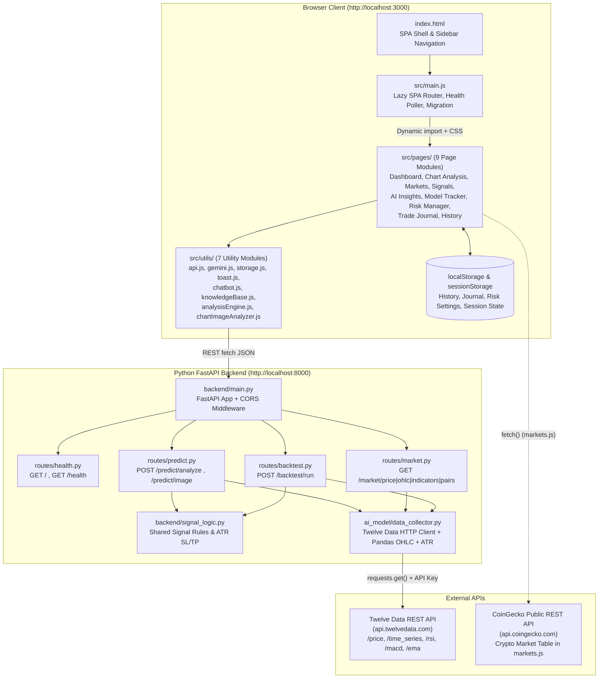

# TradeVision AI (`projectx`) — Complete Project Documentation

Comprehensive reference covering the full system architecture, technology stack, data flows, and an exhaustive file-by-file and folder-by-folder breakdown of **TradeVision AI**.

---

## 1. Project Overview

**TradeVision AI** is a full-stack trading analysis, backtesting, and trade-management web application for **Forex, Gold, and Crypto** markets (`EUR/USD`, `XAU/USD`, `GBP/USD`, `USD/JPY`, `AUD/USD`, and `BTC/USDT`).

It pairs a lightweight **Vanilla JavaScript + Vite** Single Page Application (SPA) frontend (styled in a Bloomberg Terminal dark theme) with a **Python FastAPI** backend powered by the **Twelve Data API** for real-time market prices, OHLCV candle history, and technical indicators (`RSI`, `MACD`, `EMA-20`, and local `ATR`).

---

## 2. Complete System Architecture

### 2.1 High-Level Architecture Diagram



### 2.2 Core Request Lifecycle Flows

#### Flow A: Live Chart / Signal Analysis (`POST /predict/analyze`)
1. User selects a supported pair (`EUR/USD`, `XAU/USD`, `GBP/USD`, `USD/JPY`, `AUD/USD`, or `BTC/USDT`) and timeframe on `chartAnalysis.js` or `signals.js` (and optionally uploads a chart screenshot).
2. `gemini.js` normalizes the pair (e.g. `EUR/USD` → `EURUSD`) and sends `POST /predict/analyze` via `api.js` (`http://localhost:8000/predict/analyze`).
3. `backend/routes/predict.py` validates the pair and timeframe, then calls `get_full_analysis_data()` in `ai_model/data_collector.py`.
4. `data_collector.py` queries Twelve Data for:
   - Live price (`/price`)
   - Historical candles (`/time_series`, tail 50 ascending)
   - Technical indicators (`/rsi`, `/macd`, `/ema` period 20)
   - Computes 14-period Average True Range (`ATR`) locally from the OHLC candles.
5. `predict.py` calculates `data_age_seconds` (UTC server time minus newest candle timestamp) and passes `rsi`, `macd`, `macd_signal`, `last_candle_close`, and `ema_20` into `evaluate_signal()` from `backend/signal_logic.py`.
6. `calculate_trade_levels()` computes Stop Loss (`1.5 × ATR`) and Take Profit (`3.0 × ATR`, `1:2` R:R) when a directional signal (`STRONG BUY`, `BUY`, `STRONG SELL`, `SELL`) fires.
7. If a screenshot was uploaded, `gemini.js` also calls `POST /predict/image`, where Pillow (`PIL.Image`) samples pixel RGB values to compute green vs. red candle bias.
8. Results are rendered in the UI, fed to the interactive rule-based assistant (`chatbot.js`), and saved locally to `localStorage` (`tradevision_analysis_history`).

#### Flow B: Historical Strategy Backtesting (`POST /backtest/run`)
1. User opens **Model Tracker** (`src/pages/modelTracker.js`), picks a pair, timeframe, and lookback period (30–365 days), and clicks **Run Backtest**.
2. Frontend sends `POST /backtest/run` to `backend/routes/backtest.py`.
3. `backtest.py` calls `get_ohlc_history(pair, interval, outputsize=5000)` **once** (consuming 1 Twelve Data API credit).
4. `backtest.py` computes `EMA(20)`, `MACD(12,26,9)`, `RSI(14)` (Wilder smoothing), and `ATR(14)` locally across the entire `pandas.DataFrame`.
5. Iterating candle-by-candle after warmup (`start_index >= 20`), it invokes the exact same `evaluate_signal()` and `calculate_trade_levels()` from `backend/signal_logic.py`.
6. For each non-`HOLD` signal, it scans up to the next 50 candles to check whether Take Profit or Stop Loss hits first (`win`, `loss`, or `skipped`), computes pips/points, and aggregates win rates by overall and signal strength (`strong` vs. `medium`).

---

## 3. Complete Tech Stack

### Frontend
| Component | Technology | Details |
|---|---|---|
| **Language** | Vanilla JavaScript (ES Modules) | Pure browser JS (`"type": "module"`), zero UI framework overhead |
| **Build Tool & Dev Server** | Vite (`^8.0.3`) | Instant HMR on port `3000`, dynamic chunk splitting, production bundler |
| **Markup & Styling** | HTML5 + Modular CSS3 | CSS custom properties (Bloomberg Dark Theme), per-page lazy CSS injection |
| **Browser APIs** | `fetch`, `Canvas 2D`, `localStorage`, `sessionStorage`, `Blob` / `URL`, `IntersectionObserver`, `Clipboard` | Native APIs for networking, pixel scanning, persistence, HTML export, and UI effects |
| **Typography** | Google Fonts (`Inter`, `Oswald`, `JetBrains Mono`) | Loaded in `index.html` |

### Backend & Data Layer
| Component | Technology | Details |
|---|---|---|
| **Runtime** | Python `3.11` | Powers API server and market data pipeline |
| **Web Framework** | FastAPI (`fastapi`) | Async REST API, automatic OpenAPI/Swagger docs at `/docs`, CORS middleware |
| **ASGI Server** | Uvicorn (`uvicorn`) | Serves FastAPI on `0.0.0.0:8000` with `--reload` |
| **Validation** | Pydantic (`BaseModel`) | Request body schema validation in `predict.py` and `backtest.py` |
| **HTTP Client** | `requests` | Synchronous REST calls to Twelve Data API |
| **Data Processing** | `pandas` (plus `numpy`) | OHLCV DataFrames, chronological sorting, local RSI/MACD/EMA/ATR computation |
| **Image Processing** | `Pillow` (`PIL`) | RGB pixel sampling on base64-decoded chart screenshots |
| **Env Management** | `python-dotenv` | Loads `backend/.env` for `TWELVE_DATA_API_KEY`, `PORT`, `FRONTEND_URL` |

### External Services & DevOps
| Component | Technology | Details |
|---|---|---|
| **Primary Market Data API** | Twelve Data API (`api.twelvedata.com`) | Live quotes, up to 5,000 OHLC candles per call, RSI, MACD, EMA-20 |
| **Secondary Crypto Feed** | CoinGecko API (`api.coingecko.com`) | Used on the Live Markets page (`markets.js`) with static fallback data |
| **Launcher** | Windows Batch Script (`START_TRADEVISION.bat`) | Dual-terminal launcher for FastAPI + Vite + browser auto-open |
| **Version Control** | Git / GitHub | `.gitignore` protects `.env`, `node_modules/`, `dist/`, `__pycache__/`, and `.zip` files |

---

## 4. Complete Folder & File Tree

```text
projectx/
├── .gitignore                        # Git ignore rules (secrets, caches, build output, archives)
├── index.html                        # Single-Page Application HTML shell, sidebar nav, settings modal
├── package.json                      # Frontend manifest & Vite scripts (dev, build, preview)
├── package-lock.json                 # Locked npm dependency tree for Vite
├── requirements.txt                  # Python backend dependencies
├── split.cjs                         # Utility script used to split monolithic CSS into modules
├── START_TRADEVISION.bat             # Windows one-click launcher for FastAPI + Vite + Browser
├── vite.config.js                    # Vite dev server configuration (port 3000)
├── projectx.zip                      # Backup archive (gitignored)
├── project_export.zip                # Legacy export archive (gitignored)
│
├── ai_model/                         # Python market data collection & ATR calculation layer
│   ├── __pycache__/                  # Python bytecode cache (gitignored)
│   └── data_collector.py             # Twelve Data API client, timeframe normalization, OHLC/ATR
│
├── backend/                          # Python FastAPI server
│   ├── .env                          # Local secret environment variables (gitignored)
│   ├── .env.example                  # Safe environment variable template for setup
│   ├── __pycache__/                  # Python bytecode cache (gitignored)
│   ├── main.py                       # FastAPI app factory, CORS config, router mounting
│   ├── signal_logic.py               # Shared strict signal evaluation & ATR SL/TP calculation
│   └── routes/                       # Modular API route handlers
│       ├── __init__.py               # Package marker
│       ├── __pycache__/              # Python bytecode cache (gitignored)
│       ├── backtest.py               # POST /backtest/run (pandas local indicator simulation)
│       ├── health.py                 # GET / and GET /health
│       ├── market.py                 # GET /market/price, /ohlc, /indicators, /pairs
│       └── predict.py                # POST /predict/analyze and POST /predict/image
│
├── dist/                             # Vite production bundle output (gitignored, generated by npm run build)
├── node_modules/                     # Installed frontend npm packages (gitignored)
│
└── src/                              # Frontend source code
    ├── main.js                       # SPA entry point, dynamic router, health polling, migration, UI effects
    ├── pages/                        # 9 lazy-loaded SPA page modules
    │   ├── aiInsights.js             # Market intelligence & sentiment view
    │   ├── chartAnalysis.js          # Core chart uploader, live analysis, trade setup & AI chat
    │   ├── dashboard.js              # Home overview, summary stats, quick actions
    │   ├── history.js                # Saved chart analysis backups & HTML report exporter
    │   ├── markets.js                # Live Markets table (Crypto via CoinGecko, sample Forex/Stocks)
    │   ├── modelTracker.js           # Strategy backtester UI wired to /backtest/run
    │   ├── riskManager.js            # Position sizing calculator & daily loss blocker simulator
    │   ├── signals.js                # Multi-pair live trade signal generator
    │   └── tradeJournal.js           # Manual trade logger, win rate & P&L analytics
    ├── styles/                       # Modular CSS design system
    │   ├── base.css                  # Bloomberg dark theme tokens, layout, sidebar, topbar, animations
    │   ├── components.css            # Reusable cards, buttons, forms, modals, badges, toasts
    │   └── pages/                    # Page-specific CSS dynamically injected on route change
    │       ├── aiInsights.css
    │       ├── chart.css
    │       ├── journal.css
    │       ├── markets.css
    │       ├── modelTracker.css
    │       ├── riskManager.css
    │       └── signals.css
    └── utils/                        # Shared frontend utilities & engines
        ├── analysisEngine.js         # Legacy/offline browser-only deterministic analysis engine
        ├── api.js                    # Fetch HTTP client wrapper & checkHealth()
        ├── chartImageAnalyzer.js     # Browser Canvas RGB/HSL pixel trend & candle analyzer
        ├── chatbot.js                # Rule-based context-aware trading chat assistant
        ├── gemini.js                 # Backend API bridge (legacy filename; talks to FastAPI)
        ├── knowledgeBase.js          # Static technical analysis patterns, rules & seeded RNG
        ├── storage.js                # Centralized localStorage wrapper & STORAGE_KEYS
        └── toast.js                  # Floating toast notification manager
```

---

## 5. Detailed File-by-File & Folder-by-Folder Breakdown

### 5.1 Root Directory (`projectx/`)

| File / Folder | What Is Inside | Why It Is Used |
|---|---|---|
| **`.gitignore`** | Ignore patterns for `node_modules/`, `.env`, `backend/.env`, `*.env`, `__pycache__/`, `dist/`, `.vite/`, `*.zip`, `project_export/`, and IDE/OS files. | Prevents secrets (Twelve Data API key), large dependency trees, Python caches, and build artifacts from being committed to GitHub. |
| **`index.html`** | The single HTML shell containing `#sidebar` (nav links under `MAIN`, `TRADEPEDIA`, `TOOLS`, plus live API status indicator and Settings button), `#main-content` (`topbar` + `#page-container`), `#settings-modal` (Twelve Data backend status info), Google Fonts, `base.css`, `components.css`, and `<script type="module" src="/src/main.js">`. | Entry point for the SPA; Vite serves this file and all navigation swaps views dynamically inside `#page-container` without page reloads. |
| **`package.json`** | Project metadata (`"name": "projectx"`, `"type": "module"`), scripts (`dev`, `build`, `preview`), and `"devDependencies": { "vite": "^8.0.3" }`. | Defines npm commands and frontend tooling. Uses zero runtime framework dependencies to keep the app ultra-fast. |
| **`package-lock.json`** | Exact resolved versions and integrity hashes for Vite and its transitive dependencies (e.g., Rolldown, fdir). | Guarantees reproducible `npm install` across machines. |
| **`requirements.txt`** | Lists `fastapi`, `uvicorn`, `python-dotenv`, `requests`, `pandas`, `pillow`. | Allows one-command installation (`pip install -r requirements.txt`) of all Python backend dependencies. |
| **`split.cjs`** | CommonJS Node.js script that reads a legacy `src/styles/main.css` by section banners (`/* === ... === */`) and writes `base.css`, `components.css`, and `src/styles/pages/*.css`. | Historical refactoring tool kept in root for reference on how the stylesheet was modularized. Not run at runtime. |
| **`START_TRADEVISION.bat`** | Windows batch script that opens one terminal in `backend/` running `uvicorn main:app --host 0.0.0.0 --port 8000 --reload`, a second terminal at root running `npm run dev`, waits 3 seconds, and opens `http://localhost:3000`. | Provides a one-click local startup experience on Windows without manually opening two shells. |
| **`vite.config.js`** | Exports `defineConfig({ server: { port: 3000, open: false } })`. | Pins Vite's dev server to port `3000` to match the FastAPI CORS allow-list and `.env` `FRONTEND_URL`. |
| **`projectx.zip` / `project_export.zip`** | Local compressed archive backups in the root folder (excluded from Git via `.gitignore`). | Local snapshot backups created prior to cleanup. |
| **`dist/` / `node_modules/`** | Generated Vite production build (`dist/`) and npm packages (`node_modules/`). | `node_modules/` runs Vite; `dist/` is produced by `npm run build` for static production hosting. |

---

### 5.2 Market Data Layer (`ai_model/`)

| File | What Is Inside | Why It Is Used |
|---|---|---|
| **`ai_model/data_collector.py`** | Authoritative Twelve Data REST client. Defines `SUPPORTED_PAIRS` (`EURUSD`, `XAUUSD`, `GBPUSD`, `USDJPY`, `AUDUSD`, `BTCUSDT`), `SUPPORTED_TIMEFRAMES`, `TIMEFRAME_MAP`, `normalize_timeframe()`, `check_api_response()` (masks API keys in error logs), `get_current_price()`, `get_ohlc_history()`, `get_technical_indicators()` (RSI, MACD, EMA-20), `calculate_atr()`, `get_full_analysis_data()`, `save_data_to_csv()`, and a `__main__` CLI test block. | Centralizes all external Twelve Data communication, protects against Twelve Data HTTP-200 error payloads, guarantees chronological ascending candle sorting (`ohlc[0]` oldest → `ohlc[-1]` newest), and computes standard 14-period True Range ATR. |

---

### 5.3 Backend API Server (`backend/`)

| File | What Is Inside | Why It Is Used |
|---|---|---|
| **`backend/.env`** | Local runtime secrets: `PORT=8000`, `FRONTEND_URL=http://localhost:3000`, and `TWELVE_DATA_API_KEY`. *(Gitignored, not pushed to GitHub)*. | Stores the live Twelve Data API key securely on the developer's machine. |
| **`backend/.env.example`** | Safe template containing `PORT=8000`, `FRONTEND_URL=http://localhost:3000`, `TWELVE_DATA_API_KEY=your_twelve_data_api_key_here`. | Documents required environment variables for anyone cloning the repository without exposing secrets. |
| **`backend/main.py`** | Initializes `FastAPI(title="TradeVision AI", version="2.0.0")`, loads `backend/.env`, adds `ai_model/` to `sys.path`, configures `CORSMiddleware` for ports `3000`, `3001`, `5173`, and mounts `health`, `/predict`, `/market`, and `/backtest` routers. | Main ASGI application entry point executed by Uvicorn. |
| **`backend/signal_logic.py`** | Shared rule engine exporting `evaluate_signal(rsi, macd, macd_signal, close, ema_20)` and `calculate_trade_levels(entry_price, atr_val, signal, decimals)`. Enforces strict confluence rules: **STRONG BUY** (high, 78%), **BUY** (medium, 60%, requires `close > ema_20`), **STRONG SELL** (high, 78%), **SELL** (medium, 60%, requires `close < ema_20`), and **HOLD** (low, 38%) with explicit diagnostic reasons when EMA-20 blocks a trade. | Single source of truth for trading rules so live signals (`predict.py`) and historical simulations (`backtest.py`) behave identically without code duplication. |
| **`backend/routes/__init__.py`** | Package marker comment. | Allows Python to treat `backend/routes/` as an importable package. |
| **`backend/routes/health.py`** | `GET /` (server running status) and `GET /health` (service health JSON). | Used by `src/utils/api.js` (`checkHealth()`) to toggle the live green/red status dot in the sidebar footer. |
| **`backend/routes/market.py`** | `GET /market/price/{pair}`, `GET /market/ohlc/{pair}` (supports `interval` & `limit` 1–5000), `GET /market/indicators/{pair}`, and `GET /market/pairs`. | Exposes raw Twelve Data prices, OHLCV candles, technical indicators, and supported pairs over REST. |
| **`backend/routes/predict.py`** | `POST /predict/analyze` (validates pair/timeframe, fetches live analysis data, calculates `data_age_seconds` from latest candle vs. UTC time, runs `evaluate_signal()` + `calculate_trade_levels()`) and `POST /predict/image` (decodes base64 screenshot via Pillow, samples pixels for green vs. red candle ratio, optionally enriches with live price). | Core prediction endpoint powering the Chart Analysis, Signals, and AI Insights frontend pages. |
| **`backend/routes/backtest.py`** | `POST /backtest/run` (`pair`, `timeframe`, `lookback_days`). Fetches up to 5,000 OHLC rows, computes `EMA(20)`, `MACD(12,26,9)`, `RSI(14)`, and `ATR(14)` locally with `pandas`, skips 20+ warmup candles, evaluates `signal_logic.py`, simulates 50-bar TP vs. SL outcomes (with conservative SL-first on same-bar collision), and computes pip/point P&L and win rates (`strong` vs. `medium`). | Powers the **Model Tracker** page to empirically measure strategy accuracy without burning extra Twelve Data API calls. |

---

### 5.4 Frontend Core (`src/`)

| File | What Is Inside | Why It Is Used |
|---|---|---|
| **`src/main.js`** | Imports `toast.js`, `api.js` (`checkHealth`), and `storage.js` (`STORAGE_KEYS`). Runs `migrateTradeJournalData()` (`tv_trades` → `tradevision_trade_journal`), sets up sidebar click listeners, dynamic `navigateTo(page)` with lazy `import('./pages/...')` and `loadPageCSS()`, Settings modal open/close, mobile menu toggle, 30-second health polling (`updateApiStatus()`), plus UI polish effects (`initTiltEffect`, `initScrollReveal`, `typewriterEffect`, `initCopyButtons`). | Orchestrates navigation, code-splitting, backend connectivity monitoring, and global UI micro-interactions. |

---

### 5.5 Frontend Pages (`src/pages/`)

Every page module exports a single `render<PageName>(container)` function that renders HTML into `#page-container` and attaches event listeners.

| File | Route (`data-page`) | What Is Inside | Why It Is Used |
|---|---|---|---|
| **`dashboard.js`** | `dashboard` | Hero stats grid (`Charts Analyzed` from `getAnalysisHistory()`, Market Coverage, AI Engine), Welcome card with quick-navigation buttons, 3 Platform Feature cards, and 4-step "How It Works" flow. | Landing view providing at-a-glance status and quick entry points into analysis and markets. |
| **`chartAnalysis.js`** | `chart-analysis` | Drag-and-drop / file-picker chart image uploader (up to 10 MB), Market Type selector (`Forex`, `Crypto`, `Stocks` — Stocks shows *"Coming soon — not yet connected to live data"*), restricted datalist of the 6 supported pairs, timeframe & risk parameters, `analyzeChart()` execution, signal strength meter, visual Entry/SL/TP1–3 ladder, interactive AI Chatbot panel (`chatbot.js`), `sessionStorage` persistence across tab switches, and auto-saving to `localStorage` history. | Primary workspace for analyzing trading setups and interacting with the rule-based assistant. |
| **`markets.js`** | `markets` | Tabbed market data table (`Crypto`, `Forex`, `Stocks`). Fetches top 15 coins live from **CoinGecko** (`/coins/markets`) with static fallback data on failure, while displaying curated sample reference arrays for Forex (8 pairs) and Stocks (8 tickers). | Quick multi-asset price scanner UI. *(Note: currently independent of the Twelve Data backend `/market/*` routes).* |
| **`signals.js`** | `signals` | Market tabs (`Forex`, `Crypto`, `Stocks`) and "Generate AI Signals" button. Calls `generateSignals()` in `gemini.js` for live Forex (`EURUSD`, `XAUUSD`, `GBPUSD`, `USDJPY`, `AUDUSD`) and Crypto (`BTCUSDT`) signals; renders a clear *"Coming soon — not yet connected to live data"* notice when Stocks is selected. Supports `STRONG BUY`, `BUY`, `STRONG SELL`, `SELL`, and `HOLD` cards. | Batch live signal scanner across all supported backend pairs. |
| **`aiInsights.js`** | `ai-insights` | Category buttons (`Forex`, `Crypto`, `Stocks`, `Full Overview`) calling `getMarketInsights(topic)` from `gemini.js`. Displays Market Sentiment card, Key Events tags, and Insight cards with bullish/bearish/neutral badges. | High-level live market sentiment and indicator summary view. |
| **`modelTracker.js`** | `model-tracker` | Backtester controls (`Pair` from the 6 supported pairs, `Timeframe`, `Lookback Period` 30–365 days), calls `POST /backtest/run`, displays 4 KPI cards (Overall Win Rate, Total Signals, Strong Signal Win Rate, Medium Signal Win Rate) and a scrollable trade-by-trade log table (up to 100 rows shown). | Allows users to validate TradeVision's signal rules against up to 5,000 historical candles. |
| **`riskManager.js`** | `risk-manager` | Client-side risk engine reading/writing `tradevision_risk_settings` and `tradevision_trade_log`. Features Account Balance, Risk %, Max Daily Loss %, Max Open Trades, Position Size Calculator (units, standard lots, SL distance in pips), Daily Loss Progress Meter (auto-resets on new calendar day), and Simulated Loss Logger that blocks trading when daily loss hits 100%. | Enforces disciplined position sizing and daily drawdown protection completely offline. |
| **`tradeJournal.js`** | `trade-journal` | Full trade logging form (Pair, Long/Short, Entry, Exit, Position Size, Notes) and performance dashboard (Total P&L, Win Rate, Profit Factor, Best/Worst Trade, Streak). Persists trades using `storage.get(STORAGE_KEYS.TRADE_JOURNAL)` and `storage.set(STORAGE_KEYS.TRADE_JOURNAL, ...)`. | Lets traders track real trade execution and historical P&L performance. |
| **`history.js`** | `history` | Reads saved chart analyses from `getAnalysisHistory()` (`localStorage`), displays chart thumbnails, signals, trends, and Entry/SL/TP levels, supports deleting entries, and includes `downloadAsReport()` to export single or all analyses as standalone styled `.html` files via `Blob`. | Local backup manager and portable HTML report generator for past chart analyses. |

---

### 5.6 Frontend Utilities (`src/utils/`)

| File | What Is Inside | Why It Is Used |
|---|---|---|
| **`api.js`** | Defines `API_URL = 'http://localhost:8000'`, generic `api.get()`, `api.post()`, `api.delete()` fetch wrappers with offline/HTTP error handling, and `checkHealth()` pinging `/health`. | Single centralized HTTP transport layer between the frontend and FastAPI. |
| **`gemini.js`** | **Backend API Bridge** *(legacy filename retained for import compatibility)*. Exports `normalizePair()`, `analyzeChart()` (`POST /predict/analyze` + optional `POST /predict/image`), `getMarketInsights()` (queries `EURUSD` on `/predict/analyze`), `generateSignals()` (queries supported Forex/Crypto pairs), and no-op stubs `setUseBuiltIn` / `getUseBuiltIn`. | Translates FastAPI JSON responses into the structured schema expected by `chartAnalysis.js`, `signals.js`, and `aiInsights.js`. |
| **`storage.js`** | Defines `STORAGE_KEYS` (`HISTORY`, `RISK_SETTINGS`, `TRADE_LOG`, `TRADE_JOURNAL`, `PREDICTIONS`), generic `storage` CRUD (`get`, `set`, `push`, `remove`, `clear`), and history helpers (`saveAnalysisToHistory` capped at 15 items, `getAnalysisHistory`, `deleteAnalysisFromHistory`). | Single source of truth for `localStorage` keys and serialization. |
| **`toast.js`** | Exports `initToasts()` (creates `.toast-container`) and `showToast(message, type)` supporting `success` (`✓`), `error` (`✕`), and `info` (`ℹ`) with 3.5s auto-dismiss. | Provides non-blocking user feedback across every page. |
| **`chatbot.js`** | Exports `setChatAnalysis()`, `getChatHistory()`, `clearChatHistory()`, and `processMessage()`. Rule-based keyword & intent matcher covering current chart setup advice (entry, SL, TP, R:R), indicators (RSI, MACD, EMA, Bollinger), patterns, risk rules, scalping, swing trading, news, and psychology. | Powers the interactive Q&A sidebar inside `chartAnalysis.js` without needing an external LLM. |
| **`knowledgeBase.js`** | Static reference dictionaries (`CHART_PATTERNS`, `INDICATOR_RULES`, `TIMEFRAME_CONTEXT`, `MARKET_KNOWLEDGE`, `RISK_MANAGEMENT_RULES`) plus deterministic `seededRandom()` and `stringToSeed()`. | Supplies educational/technical definitions to `chatbot.js` and `analysisEngine.js`. |
| **`chartImageAnalyzer.js`** | Browser HTML5 `<canvas>` computer-vision scanner (`analyzeChartImage()`). Uses `rgbToHsl()`, histogram background detection, chart bounding-box cropping (excluding axes), 40-column brightness center-of-mass linear regression, green/red candle hue pixel counting, volatility range estimation, and 4-factor weighted `buildTrendConsensus()`. | Performs client-side visual chart inspection in the browser. |
| **`analysisEngine.js`** | Legacy 100%-client-side deterministic analysis engine (`analyzeChart`, `getMarketInsights`, `generateSignals`, `processWorkerTask`). Combines `chartImageAnalyzer.js` with `knowledgeBase.js` and seeded PRNG. | Kept as an offline fallback/reference module while live traffic routes through `gemini.js` → FastAPI. |

---

### 5.7 Styles (`src/styles/`)

| File / Folder | What Is Inside | Why It Is Used |
|---|---|---|
| **`src/styles/base.css`** | **Bloomberg Terminal Dark Theme** variables (`#0A0A0A`–`#202020` backgrounds, `#00B300` Bloomberg Green accent mapped onto legacy `--purple-*` tokens, semantic red/amber/blue), resets, responsive sidebar & topbar layout, and keyframe animations (`fadeIn`, `pulse`, `spin`, `toastIn`). | Establishes the consistent dark terminal aesthetic across the entire application. |
| **`src/styles/components.css`** | Shared UI primitives: `.card` (with hover lift & top accent bar), `.stats-grid`, `.content-grid`, `.btn`, form controls, `.modal-overlay` / `.modal`, `.card-badge`, `.toast`, and utility classes. | Ensures uniform component behavior across all pages. |
| **`src/styles/pages/*.css`** | 7 page-specific stylesheets: `aiInsights.css`, `chart.css`, `journal.css`, `markets.css`, `modelTracker.css`, `riskManager.css`, and `signals.css`. | Loaded lazily by `loadPageCSS()` in `main.js` only when a user navigates to the corresponding page, keeping initial page load minimal. |

---

## 6. API Endpoints Reference

| Method | Endpoint | Handler | Description |
|---|---|---|---|
| `GET` | `/` | `backend/routes/health.py` | Basic server status check |
| `GET` | `/health` | `backend/routes/health.py` | Detailed health check polled by `checkHealth()` |
| `POST` | `/predict/analyze` | `backend/routes/predict.py` | Live Twelve Data analysis, strict signal evaluation, ATR SL/TP, and `data_age_seconds` |
| `POST` | `/predict/image` | `backend/routes/predict.py` | Pillow RGB pixel analysis on uploaded chart image + optional live price |
| `GET` | `/market/pairs` | `backend/routes/market.py` | Lists all 6 supported trading pairs |
| `GET` | `/market/price/{pair}` | `backend/routes/market.py` | Fetches latest live price for a supported pair |
| `GET` | `/market/ohlc/{pair}` | `backend/routes/market.py` | Fetches historical OHLCV candles (`interval`, `limit` up to 5000) |
| `GET` | `/market/indicators/{pair}` | `backend/routes/market.py` | Fetches latest RSI, MACD, and EMA-20 for a pair |
| `POST` | `/backtest/run` | `backend/routes/backtest.py` | Runs 5,000-candle historical backtest using pandas indicators & shared signal rules |

*(Interactive OpenAPI documentation is automatically served by FastAPI at `http://localhost:8000/docs`.)*

---

## 7. Browser Storage Schema

| Storage Mechanism | Key | Owner | Purpose |
|---|---|---|---|
| `localStorage` | `tradevision_analysis_history` | `storage.js` / `chartAnalysis.js` / `history.js` | Stores up to 15 recent chart analyses (base64 image + JSON results) |
| `localStorage` | `tradevision_risk_settings` | `riskManager.js` | Account balance, risk %, max daily loss %, max trades, daily loss counter |
| `localStorage` | `tradevision_trade_log` | `riskManager.js` | Simulated loss log (up to 50 entries) |
| `localStorage` | `tradevision_trade_journal` | `tradeJournal.js` / `storage.js` | Logged manual trades, P&L, direction, and notes *(auto-migrated from legacy `tv_trades` on boot in `main.js`)* |
| `localStorage` | `tv_model_predictions` | `storage.js` | Reserved key for saved model predictions |
| `sessionStorage` | `chartAnalysisState` | `chartAnalysis.js` | Preserves uploaded chart, form inputs, results, and chat messages when switching pages |

---

## 8. Running & Building the Application

### Quick Start (Windows)
Double-click **`START_TRADEVISION.bat`** in the project root.

### Manual Startup
1. **Install dependencies** *(first time only)*:
   ```powershell
   pip install -r requirements.txt
   npm install
   ```
2. **Configure environment** *(ensure `backend/.env` exists based on `backend/.env.example`)*:
   ```env
   PORT=8000
   FRONTEND_URL=http://localhost:3000
   TWELVE_DATA_API_KEY=your_twelve_data_api_key_here
   ```
3. **Start Backend** *(Terminal 1)*:
   ```powershell
   cd backend
   uvicorn main:app --host 0.0.0.0 --port 8000 --reload
   ```
4. **Start Frontend** *(Terminal 2)*:
   ```powershell
   npm run dev
   ```
5. **Access URLs**:
   - **Web App:** `http://localhost:3000`
   - **Backend API:** `http://localhost:8000`
   - **Swagger Docs:** `http://localhost:8000/docs`

### Production Build
```powershell
npm run build
npm run preview
```

---

## 9. Key Architectural Decisions

1. **Zero-Framework Frontend + Lazy Loading:** Plain ES modules with dynamic `import()` and on-demand page CSS keep bundle sizes minimal while delivering full SPA responsiveness.
2. **Shared Python Signal Engine (`backend/signal_logic.py`):** Centralizing signal rules and ATR SL/TP math guarantees zero drift between live signals (`/predict/analyze`) and historical backtesting (`/backtest/run`).
3. **Credit-Efficient Backtesting:** Fetching 5,000 OHLC candles in a single `/time_series` call and computing RSI, MACD, EMA-20, and ATR locally in `pandas` avoids hitting Twelve Data's free-tier rate limits (8 calls/min, 800 calls/day).
4. **Client-Side Persistence:** Storing user history, risk controls, and trade journals in `localStorage` removes database hosting requirements and keeps user trade logs private to their browser.
